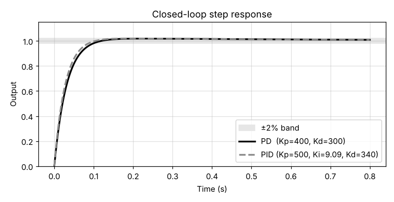
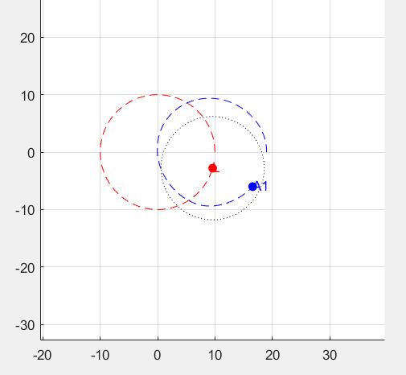

# Leader-Follower Formation Control (MATLAB)

A vehicle A has to stay on a circle of radius 9 m around a moving leader L, whatever the leader does. This project models the vehicle, linearizes it, designs PD and PID controllers that meet a step-response spec, and tests them in animated simulations against five leader trajectories.



**Individual project**, undergraduate Mechanical Engineering, Cyprus University of Technology (April 2025). All code and analysis are my own.

## The problem

The vehicle has mass m = 9 kg and damping c = 5. It is pushed by two forces: Fr along the line to the leader and Fn tangent to the circle. Since these forces turn with the vehicle, the full model is nonlinear: a rotation matrix maps them into the x-y frame at every step.

Linearizing around the circle gives the same plant for each axis:

```
G(s) = 0.11 / ( s (s + 0.556) )
```

The controller had to meet two targets on a unit step: **overshoot below 4%** and **2% settling time below 0.6 s**.

## Approach

1. **Nonlinear model.** State-space simulation with Euler integration (dt = 0.01 s) under constant forces, against five leader paths: slow and fast straight lines, slow and fast circles, and a chaotic path.
2. **Linearized model.** The same setup with the linear model and open-loop force inputs, to see how far the vehicle drifts with no control.
3. **Controller design.** I showed analytically that a P controller cannot meet both targets at once. A PD controller can, and so can a PID, which also removes the steady-state error in theory. Gains were found by matching the closed-loop characteristic polynomial to the targets.
4. **Closed-loop tests.** Each controller runs on both the nonlinear and the linearized model for five leader paths (straight lines, circles and a spiral). The scripts animate the motion and plot the radius error and angle error over time.

## Results

| Controller | Gains | Overshoot | Settling time (2%) | Steady-state error |
|---|---|---|---|---|
| PD | Kp = 400, Kd = 300 | 1.86% | 0.099 s | 0.0075 |
| PID | Kp = 500, Ki = 9.09, Kd = 340 | 1.96% | 0.086 s | 0.0084 |

Both controllers meet the targets with a wide margin. In the formation tests, PID gave a smoother response than PD on the nonlinear model, with smaller error peaks and fewer oscillations. The difference was clearest on the fast circle and spiral paths, where the leader changes direction quickly: on the fast circle, the peak radius error dropped from about 10 m with PD to about 9 m with PID. The linearized model stayed stable in every scenario.



*Nonlinear model with PID control: the leader (red) moves on a circle and vehicle A1 (blue) follows on its own circle around it.*

## Repository structure

```
01_nonlinear_model/    nonlinear model, open loop, 5 leader paths
02_linearized_model/   linearized model, open loop
03_pd_design/          PD step response and spec check
04_pd_formation/       PD on the nonlinear (A1) and linearized (A2) models
05_pid_formation/      PID step response and PID on both models
media/                 figures
```

In the plots, **L** is the leader, **A1** is the vehicle with the nonlinear model and **A2** is the vehicle with the linearized model.

## How to run

You need MATLAB with the **Control System Toolbox** (`tf`, `feedback`, `step`, `stepinfo`) and the **Mapping Toolbox** (`wrapToPi`).

Open the folder you want in MATLAB and run its main script:

| Folder | Run |
|---|---|
| `01_nonlinear_model` | `simulate_nonlinear` |
| `02_linearized_model` | `simulate_linear` |
| `03_pd_design` | `pd_step_response` |
| `04_pd_formation` | `pd_nonlinear` or `pd_linear` |
| `05_pid_formation` | `pid_step_response`, `pid_nonlinear` or `pid_linear` |

Each formation script plays the five scenarios one after the other, with a short pause between them.

## Tools

MATLAB, Control System Toolbox.
